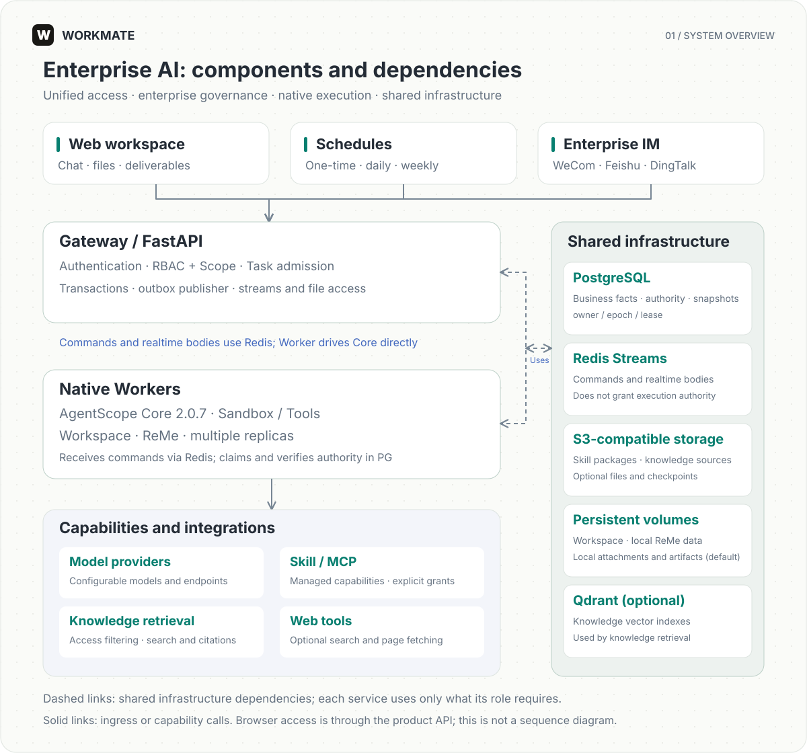

# Workmate

[English](README.md) | [简体中文](README.zh-CN.md)

[Get started](docs/en/getting-started.md) · [Architecture](docs/en/architecture.md) · [Access governance](docs/en/administration.md) · [Deployment](docs/en/deployment.md)

**Put AI to work across your team—with clear permissions, scalable execution, and tangible results.**

Workmate is an open-source AI Agent platform for enterprise teams. Built around **RBAC + Scope access control** and **distributed execution designed for horizontal scaling**, it brings Agents, company knowledge, business tools, and a file workspace into one place. Teams can share AI capabilities according to organizational responsibilities and get work done within explicit authorization and approval boundaries.

Self-host Workmate, configure your model endpoints, and build on code licensed under Apache-2.0. Shape your AI workmates around your organization, tools, and business processes.

## Why Workmate

- **Enterprise access control.** RBAC defines what people can do; Scope defines where they can do it. Organization, department, and personal boundaries let teams share AI capabilities with clear permissions.
- **Distributed execution that grows with your team.** Deploy Gateway and Workers separately, add Worker replicas, and use fixed multi-node deployments to expand concurrent processing across conversations. [Explore deployment options](docs/en/deployment.md).
- **Shared capabilities, centrally managed.** Manage Skills and MCP connections in organization libraries. Equip Agents with knowledge bases, models, and long-term memory, and share tools and knowledge through explicit grants.
- **Useful deliverables, in one workspace.** Work with attachments, follow tool execution, and preview or download documents, code, and other outputs. Artifact access remains governed by product permissions.
- **Human oversight where it matters.** Sandboxes, tool policies, approvals, and traceable cancellation constrain execution. Platform management actions leave audit records.
- **Durable state and explicit recovery.** Execution ownership checks guard against duplicate commands and stale Workers. Resume after approval or explicitly recover eligible failures, with optional checkpoints for saved working files. [Learn about tasks and recovery](docs/en/runtime.md).
- **Automation in everyday collaboration.** Schedule one-time, daily, or weekly work, start tasks through WeCom, Feishu, or DingTalk, and receive scheduled results in the owner's bound direct messages.

## Built for everyday team workflows

- **Knowledge and research**: combine authorized knowledge bases and search tools to organize material, answer questions, and produce research findings.
- **Analysis and file delivery**: work with uploaded files and available Skills to analyze data, prepare reports, and deliver usable outputs.
- **Business tools and automation**: connect managed MCP services, schedule recurring work, and bring Agents into enterprise messaging.

Start with one workspace, configure capabilities and permissions for your team, and add Workers as concurrent workloads grow.

## Get started

Use Linux and Docker Compose v2. Configure model and storage credentials, build the application images, and initialize your organization.

Follow [getting started](docs/en/getting-started.md) for the complete commands and required settings. The supplied configuration enables optional knowledge and Web services; the guide explains both the full and minimal setup.

Default endpoints are `http://localhost:3000` for the workspace and `http://localhost:8080/docs` for API documentation.

## Architecture

Workmate uses AgentScope 2.0.7 as its Agent execution core. The product API owns authorization and task admission. PostgreSQL records business facts and execution authority; Redis Streams transports commands and realtime output. Workers drive Core directly. See [architecture](docs/en/architecture.md).

## Documentation

- [Documentation index](docs/en/README.md)
- [User guide](docs/en/user-guide.md)
- [Configuration](docs/en/configuration.md)
- [Deployment](docs/en/deployment.md)
- [Administration and security](docs/en/administration.md)
- [Development and contributing](docs/en/development.md)
- [Support boundaries and limitations](docs/en/limitations.md)

Workmate is under active development. Validate your models, integrations, sandbox, and deployment topology before production use. Implemented recovery does not imply transparent cross-host takeover or universal capacity guarantees.

## Dependencies and attribution

Workmate uses [AgentScope](https://github.com/agentscope-ai/agentscope). Third-party source and bundled Skills retain their own licenses and attribution. See the [AgentScope-derived MCP license](packages/product/src/workmate_product/mcp/LICENSE.agentscope) and license files accompanying bundled Skills.

## License

Original Workmate code is licensed under [Apache-2.0](LICENSE). Third-party components retain their own terms; see [third-party sources](docs/en/third-party.md) and [NOTICE](NOTICE).
