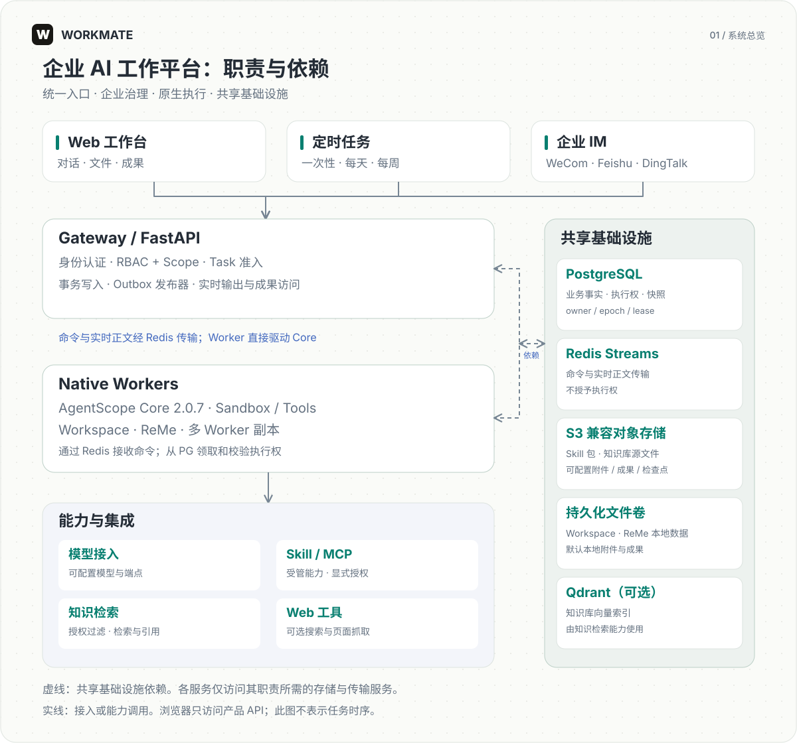

# Workmate

[English](README.md) | [简体中文](README.zh-CN.md)

[快速开始](docs/zh-CN/getting-started.md) · [系统架构](docs/zh-CN/architecture.md) · [权限治理](docs/zh-CN/administration.md) · [部署指南](docs/zh-CN/deployment.md)

**让 AI 成为团队生产力：权限有边界，执行可扩展，成果可交付。**

Workmate 是面向企业团队的开源 AI Agent 工作平台。以 **RBAC + Scope 企业权限体系**和**支持横向扩展的分布式执行架构**为基础，将智能体、企业知识、业务工具和文件工作空间整合到统一工作台，让团队按组织职责共享 AI 能力，在明确的授权与审批边界内完成工作。

支持自托管与可配置的模型接入，自有代码采用 Apache-2.0 许可。你可以围绕自己的组织结构、工具和业务流程，构建团队的 AI 工作伙伴。

## 为什么选择 Workmate

- **企业权限，细到角色与范围。** RBAC 定义“能做什么”，Scope 定义“在哪个范围内生效”，覆盖组织、部门与个人，让团队共享 AI 能力时保持清晰的权限边界。
- **分布式执行，让 AI 工作能力随团队扩展。** Gateway 与 Worker 分离部署，支持多 Worker 副本和固定多节点部署，可扩展不同会话的并发处理能力。[了解扩展部署](docs/zh-CN/deployment.md)。
- **能力统一管理，团队按需共享。** 在组织库管理 Skill 和 MCP 连接，为智能体配置知识库、模型与长期记忆，通过显式授权复用工具和知识。
- **从对话到成果，工作有落点。** 在一个工作台处理附件、跟踪工具执行，预览和下载文档、代码与其他成果文件，交付内容继续受权限控制。
- **关键操作有人把关。** 沙箱、工具策略、人工审批和可追踪的停止流程共同约束执行；平台管理操作保留审计记录。
- **任务状态持久化，恢复有依据。** 执行归属校验约束重复命令和失效 Worker，支持审批续跑与符合条件的显式故障恢复。可选文件检查点保留已保存的工作文件。[了解任务与恢复](docs/zh-CN/runtime.md)。
- **自动化融入日常协作。** 用一次性、每天或每周计划安排工作，通过企业微信、飞书、钉钉发起任务，并将定时结果发送到本人绑定的私聊。

## 为哪些工作而设计

- **团队知识与研究**：结合已授权的知识库和检索工具，整理资料、回答问题并形成研究结果。
- **办公分析与文件交付**：围绕上传文件和可用 Skill，完成数据分析、报告编写及成果交付。
- **企业工具与日常自动化**：通过受管 MCP 连接业务工具，用定时任务和企业 IM 将 AI 融入日常协作。

从一个工作空间起步，按团队需要配置能力、划分权限，再通过多 Worker 扩展并发执行资源。

## 开始使用

使用 Linux 和 Docker Compose v2，配置模型与存储凭据，构建应用镜像并初始化组织。

完整命令与必要配置见 [快速开始](docs/zh-CN/getting-started.md)。仓库配置已启用可选的知识库与 Web，指南同时说明完整部署与最小工作台的配置方式。

默认工作台地址为 `http://localhost:3000`，API 文档为 `http://localhost:8080/docs`。

## 架构

Workmate 使用 AgentScope 2.0.7 作为 Agent 执行内核。产品 API 负责授权和任务准入。PostgreSQL 保存业务事实与执行权，Redis Streams 传输命令和实时正文，Worker 直接驱动 Core。详见 [系统架构](docs/zh-CN/architecture.md)。

## 文档

- [文档目录](docs/zh-CN/README.md)
- [使用指南](docs/zh-CN/user-guide.md)
- [配置说明](docs/zh-CN/configuration.md)
- [部署运维](docs/zh-CN/deployment.md)
- [管理与安全](docs/zh-CN/administration.md)
- [开发与贡献](docs/zh-CN/development.md)
- [支持范围与限制](docs/zh-CN/limitations.md)

项目处于活跃开发阶段。生产使用前需验证实际模型、集成、沙箱及部署拓扑。现有恢复能力不代表运行任务可以跨机透明接管，也不构成通用容量保证。

## 依赖与署名

Workmate 使用 [AgentScope](https://github.com/agentscope-ai/agentscope)。第三方源码和内置 Skill 保留各自的许可证与署名，参见 [AgentScope 衍生 MCP 许可](packages/product/src/workmate_product/mcp/LICENSE.agentscope) 及各 Skill 随附的许可文件。

## 许可

Workmate 自有代码采用 [Apache-2.0](LICENSE)。第三方组件保留各自许可，详见[第三方来源](docs/zh-CN/third-party.md)和 [NOTICE](NOTICE)。
