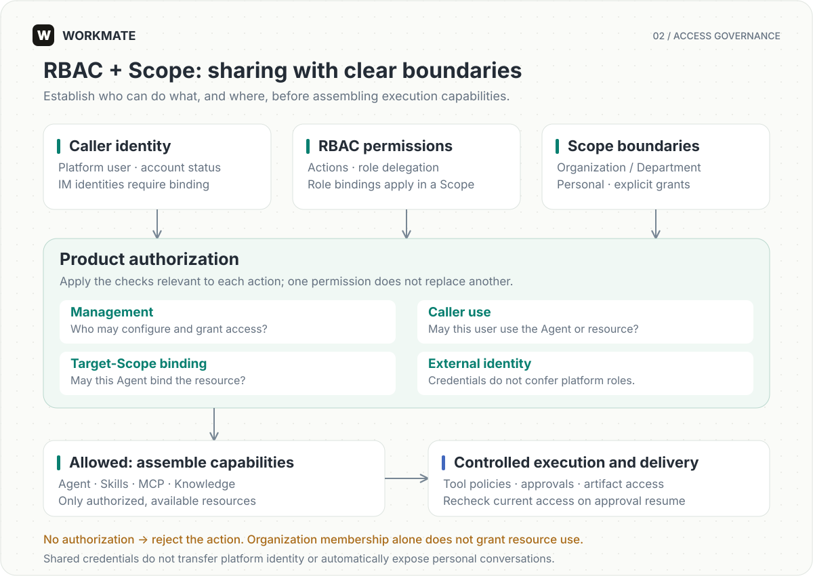

# Administration and security

[English](../en/administration.md) | [简体中文](../zh-CN/administration.md)

Define how your team uses AI through roles, departments, and explicit resource sharing. This guide covers account management, access control, approvals, and auditing.

## Organization and accounts

Initial setup creates the organization and its root administrator. The default `bootstrap_only` registration mode allows initial setup only; `closed` disables registration. Create members through user management afterwards, avoid shared administrator accounts, and retain at least two available root administrators.

Management actions are authorized by specific permissions and scopes. Account management, role binding, and department management are separate permissions. Authorized administrators can rename the organization without changing its identity or resource IDs.

The system prevents removal of the last active root administrator. On `last_root_admin`, configure and verify another administrator before demoting or disabling the original account. Disabling an account invalidates its old JWTs and submits task stop intents; it does not prove execution resources have finished cleanup.

## Scopes and sharing

Organization, Department, and Personal define resource and authorization boundaries. Department membership, management responsibilities, and resource-use grants are separate. Sharing does not transfer ownership or disclose credentials automatically.

Skills and MCP connections are managed in an organization library and shared through explicit grants. Sharing an Agent also checks its Skill, MCP, and knowledge dependencies; additional grants require confirmation by an authorized manager. Knowledge retrieval access does not automatically include source-document download access.

Management rights, caller use rights, binding rights in the Agent's target Scope, and external service identity are checked separately. Shared MCP credentials cannot become the Agent's platform administrator identity. Account management permission does not automatically grant access to personal conversations.

## Changes and revocation

Reload and review differences on version conflicts instead of blindly retrying stale drafts. Moving departments changes inheritance paths; delegated roles cannot exceed the grantor's authority. Revocation blocks subsequent admission or approval resume. It does not automatically undo external actions or retract delivered content.

References may block department or role deletion. Resolve reported blockers first. Do not bypass permissions, versions, or last-administrator protection by deleting database rows directly.

## Approval and audit

Platform management write tools require explicit confirmation, including under Full Access. Unattended tasks reject operations requiring interactive approval. Management audit records track access and configuration changes; Activity in the workspace shows tool execution within a task.

Query management audits through `/api/admin/security-audit-events` within the authorized scope. Audit data must not contain passwords, JWTs, complete authorization headers, or MCP secrets. Troubleshooting material and backups also need access control.

## Execution environment

Default Bubblewrap isolates Agent tool processes; service credentials must stay outside the Agent environment. The Local backend provides no sandbox isolation and is suitable only where that boundary is explicitly accepted. External side effects require their own authorization and business idempotency; queue deduplication does not guarantee exactly-once execution of arbitrary external actions.
