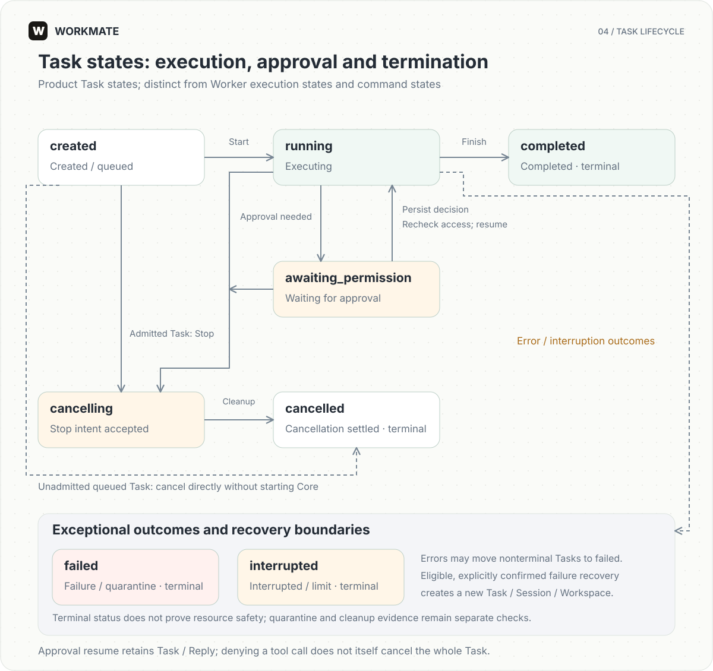
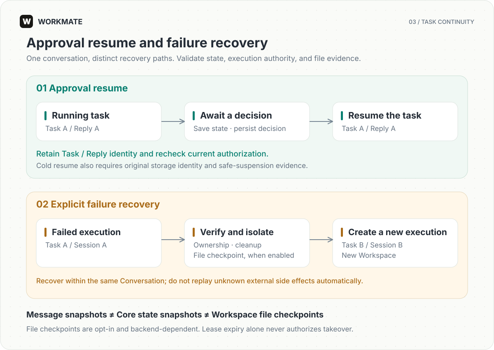

# Tasks and recovery

[English](../en/runtime.md) | [简体中文](../zh-CN/runtime.md)

Learn how tasks execute, wait for approval, stop, and recover. Use this guide to interpret workspace status and plan recovery for your deployment.

## Task state machine



The diagram shows principal paths for product `Task.status`, not RuntimeSession, internal Worker execution, or command delivery states.

- Normal execution: `created → running → completed`. `created` includes queuing and startup preparation; receiving a Redis message alone does not establish execution.
- Approval resume: `running → awaiting_permission → running`. Persist decisions and recheck authorization before resuming the same Task / Reply. Denying one tool call does not automatically cancel the Task.
- Stop: admitted Tasks move from `created`, `running`, or `awaiting_permission` to `cancelling`, then to `cancelled` after Stop settlement. Queued Tasks not yet admitted to execution may move directly from `created` to `cancelled`.
- Exceptional termination: execution errors or quarantine may produce `failed`; Core interruption or iteration limits may produce `interrupted`. These are terminal product states, alongside `completed` and `cancelled`.

Terminal status does not prove safe resource cleanup. Quarantine, execution authority, and cleanup evidence require separate checks. Only eligible failures can be explicitly recovered into a new Task; there is no general transition that turns the old `failed` Task back into `running`.

## Execution

Gateway checks the user, Agent, resources, and capacity, then persists the Task and outbox intent. After Redis Streams delivers the command, Worker claims execution authority in PostgreSQL and assembles Core, Workspace, and authorized capabilities. Business events project into product state; bounded realtime transport presents body text.

Tasks within a conversation execute serially. Execution updates must match the owner and epoch; heartbeats maintain the lease. Duplicate commands, process restarts, and reconnects cannot bypass these constraints. Redis failure does not trigger implicit database scanning for execution.

## Approval resume



Tasks and Replies retain their identity while awaiting confirmation. Decisions are persisted before resume, which rechecks current identity and resource access. Backends supporting safe suspension must save Core state and resource evidence before releasing compute and execution authority. Without those records, the system cannot treat the execution as safely suspended.

Resuming the same Task after releasing its execution process requires verification of the original storage identity. Docker requires the original daemon and volume; Kubernetes requires the original cluster, namespace, and PVC. A newly created empty volume cannot substitute for missing or replaced workspace storage.

## Stop and failure

Stop is a durable intent. Worker ends Core/tool execution, cleans resources, and closes delivery before settling terminal state. Accepted cancellation does not prove an external process has exited. Isolation gates remain when ownership or cleanup cannot be proven.

Failure recovery differs from approval resume: explicit recovery creates a new Task, RuntimeSession, and Workspace within the same Conversation. It isolates old execution without automatically replaying unknown side effects or queued tasks.

## File checkpoints

`product.artifacts.storage.workspace_checkpoint_enabled` is disabled by default and requires S3 artifact storage. Checkpoints capture ordinary files and directories under `input/working/output` at quiescent delivery or approval boundaries. They exclude processes, locks, Core state, and ReMe private data.

Files are written immutably and verified before publishing the database manifest. Exceeding file-count, per-file, or total-size limits invalidates the whole checkpoint rather than silently omitting content. The latest usable checkpoint may lag behind working files.

Bubblewrap, Docker, and Kubernetes have file checkpoint recovery adapters. E2B, Daytona, and OpenSandbox do not provide equivalent recovery. A recovered Session does not migrate the original ReMe node and temporarily disables long-term memory access. Cross-node cleanup of historical workspaces remains limited and still requires lock and ownership checks.

## Storage and retention

Message snapshots support browser recovery, Core snapshots support execution recovery, and file checkpoints support file recovery. Bounded Redis body retention is not permanent audit storage. Check database, historical execution-specification, and immutable-version references before object cleanup.

Skill object auditing is read-only:

```bash
PYTHONPATH=backend:packages/product/src:packages/contracts/src backend/.venv/bin/python scripts/audit_skill_objects.py --check --grace-days 7
```

The command reads the target deployment's database and `SKILL_S3_*` environment variables. `orphan_candidate` is only a candidate in an audit snapshot, not permission for immediate online deletion: concurrent publishing can upload an object before committing metadata.
