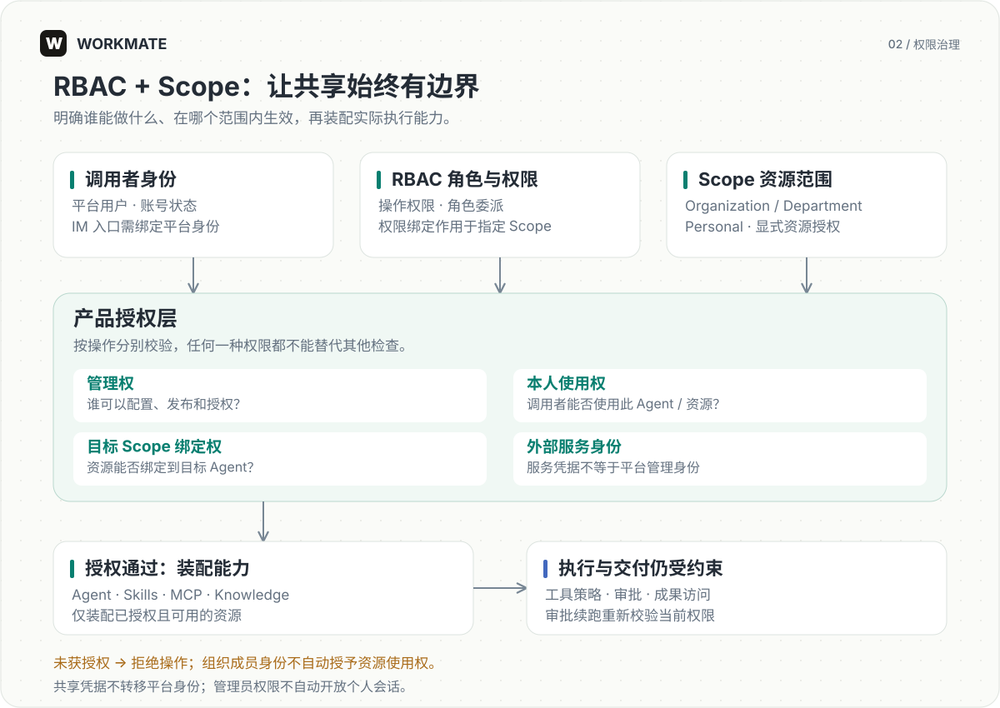

# 系统架构

[English](../en/architecture.md) | [简体中文](../zh-CN/architecture.md)

Workmate 采用产品服务与执行服务分离的架构，以 AgentScope 2.0.7 为执行内核，为团队提供统一的权限管理、智能体执行和文件交付能力。

系统分为接入、产品与执行、能力集成、共享基础设施四个部分。PostgreSQL、Redis Streams、S3 兼容对象存储、持久化文件卷与可选 Qdrant 同属基础设施；连线表示组件依赖，各服务按职责访问所需存储。浏览器只访问产品 API。

Gateway 在同一事务中保存 任务与待发布命令（Outbox），由应用侧发布器将命令送入 Redis Streams。Worker 消费命令后，从 PostgreSQL 领取并校验执行权。对象存储保存 Skill 包和知识库源文件；附件与成果默认使用本地持久化存储，也可配置为 S3，文件检查点需单独启用。

## 组件与职责

| 位置 | 职责 |
|---|---|
| `frontend/` | Next.js 工作台，只访问产品 API |
| `backend/` | FastAPI Gateway、认证授权、任务受理、事件状态更新和 Alembic |
| `runtime/` | 原生 Worker，直接装配并驱动 AgentScope Core |
| `packages/contracts/` | 共享协议类型 |
| `packages/product/` | 共享产品业务、持久化、配置和资源治理 |

Gateway 入口为 `app.main:app`，Worker 入口为 `workmate_runtime.roles.worker`。浏览器不直接连接 AgentScope。Worker 通过命令队列接收任务。

## 分布式执行与横向扩展

Workmate 将产品入口与 Agent 执行分离，让团队可以随任务量增长扩展执行资源，同时保留统一的权限、任务记录和成果访问入口。

- **多 Worker 承接并发任务。** Redis Streams 传递执行命令，Worker 在 PostgreSQL 中领取并校验执行权。增加副本可扩展不同会话的处理并发，同一会话内仍串行执行。
- **共享状态，明确执行归属。** Task、控制意图和执行证据持久化在共享服务中；owner / epoch / lease 校验约束重复投递与失效 Worker。增加进程不改变授权边界。
- **按存储拓扑扩展。** 同节点副本共享持久工作集；固定多节点部署使用明确的存储节点身份、节点路由与 S3 文件存储，保持用户与 Agent 的存储归属。

横向扩展提高可承载的并发执行数量，不会自动加速单个任务，也不等于运行中任务可以跨机器透明迁移。模型配额、数据库、队列和存储仍影响整体容量；部署条件见[多 Worker 与多机器](deployment.md)。

## 领域对象

Conversation 是用户对话；Task 是产品任务记录；Reply 是 AgentScope 的一次回复执行。`tasks.run_id` 保存 Reply 的 `reply_id`。

RuntimeSession 表示运行时会话，Workspace 保存执行文件。消息快照用于恢复页面内容，Core 状态快照用于恢复执行上下文，Workspace 文件检查点用于恢复工作文件。

组织、部门和个人范围（Scope）管理资源边界。授权由产品层判定，再将精确能力集合装配到当前执行环境；共享服务凭据不改变调用者身份。

## 授权如何进入执行

角色权限与 Scope 共同约束操作，资源共享仍需显式授权。完整策略见[管理与安全](administration.md)。

## 一致性边界

PostgreSQL 保存执行所有者、epoch、lease 与产品业务事实。Redis Streams 负责传输，重复消息不能单独授予执行权。Start、Resume、Stop 与同事务出站意图关联。

租约过期不能独立证明旧进程、工具或 Workspace 已停止。恢复必须核对执行权与持久化资源证据；无法证明安全清理时保留隔离状态。外部操作仍需业务幂等机制，消息去重不保证其恰好执行一次。

应用层统一管理事务，Repository 封装 SQL 和锁并使用调用方事务。网络调用安排在长事务和持锁区间之外，减少并发等待。

## 事件与成果

`runtime_seq`、`product_seq`、`business_seq` 与 Redis 传输游标职责不同。实时正文使用有界 Streams，数据库保留业务事实和消息快照。浏览器超出回放窗口时执行明确 reset，由客户端重新加载服务端快照。

`task_events` 保存产品审计事件；工具执行活动、浏览器事件回放和运行时消息传输分别维护对应记录。成果由 `present_files` 声明或文件差异投影形成，下载通过产品授权。

## AgentScope 契约

Core 事件通过 `session_id` / `reply_id` 标识执行。审批续跑的合成 ReplyStart 可以复用同一 `reply_id`，消费端不能据此清空历史正文。

Workspace 的 Skill/MCP 操作按 Agent 与 Session 隔离。ReMe 在 Runtime 进程内运行。Worker 直接调用 Core，产品 API 统一提供外部 HTTP 与事件流接口。

任务状态机、执行和恢复细节见 [任务与恢复](runtime.md)，部署边界见 [限制](limitations.md)。
