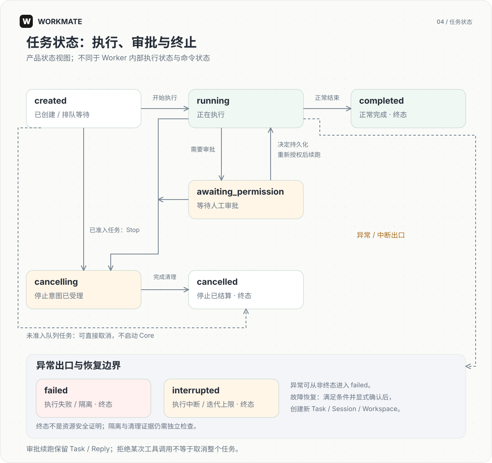
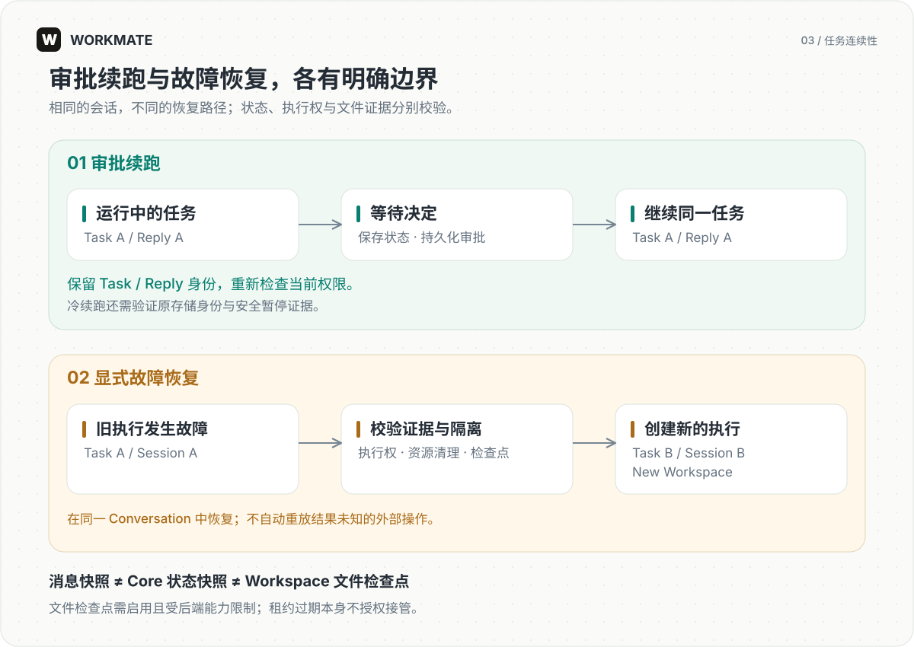

# 任务与恢复

[English](../en/runtime.md) | [简体中文](../zh-CN/runtime.md)

本指南说明任务如何执行、等待审批、停止及恢复，便于理解工作台状态和部署时的数据恢复要求。

## 任务状态机



图示产品任务状态 `Task.status` 的主要变化路径。运行时会话（RuntimeSession）、Worker 内部执行和命令投递各有独立状态。

- 正常执行：`created → running → completed`。`created` 包括排队与启动准备；开始执行并不等于仅收到 Redis 消息。
- 审批续跑：`running → awaiting_permission → running`。决定持久化并重新检查授权后才能续跑，Task / Reply 不变；拒绝单次工具调用不自动等同于取消任务。
- 停止：已准入任务从 `created`、`running` 或 `awaiting_permission` 进入 `cancelling`，完成停止结算后进入 `cancelled`。尚未准入执行的队列任务可直接从 `created` 进入 `cancelled`。
- 异常终止：执行错误或隔离可进入 `failed`；Core 中断或达到迭代上限可进入 `interrupted`。这两个状态与 `completed`、`cancelled` 都是产品终态。

终态不证明资源已经安全清理。隔离状态、执行权和清理证据仍须独立核对。只有满足恢复条件的故障任务才能显式恢复为新 Task；不存在把旧 `failed` Task 直接改回 `running` 的通用重试路径。

## 执行链

Gateway 检查用户、智能体、资源权限与可用容量，保存任务和待发布命令。命令投递到 Redis Streams 后，Worker 在 PostgreSQL 中领取执行权，装配 Core、Workspace 和授权能力。业务事件更新产品状态，回复正文通过具有保留上限的实时事件流传回工作台。

同一会话串行执行。执行更新需要匹配 owner 与 epoch，心跳维持 lease。命令重复投递、进程重启或连接重建不能绕过这些约束。Redis 故障不触发隐式数据库扫描执行。

## 审批续跑



需要确认时，Task/Reply 保持其身份。审批决定先持久化，续跑前重新检查当前身份和资源授权。支持安全暂停的后端需保存 Core 状态和资源证明，才能释放计算与执行权；缺少这些记录时，系统会阻止按已安全暂停的状态处理。

释放执行进程后恢复同一任务时，需要验证原存储身份。Docker 需要原 Docker 守护进程与存储卷，Kubernetes 需要原集群、命名空间和持久卷声明（PVC）。缺失或替换的存储不能通过创建空卷冒充原 Workspace。

## 停止和故障

停止请求会先持久化，再由 Worker 执行。Worker 停止 Core/工具、清理资源并关闭交付后才能结算终态。取消请求被接受不等于外部进程已退出。无法证明所有权或资源清理时，隔离门禁继续阻止不安全重用。

故障恢复与审批续跑不同：显式故障恢复在同一 Conversation 内创建新的 Task、RuntimeSession 和 Workspace，隔离旧执行，不自动重放未知副作用或积压任务。

## 文件检查点

`product.artifacts.storage.workspace_checkpoint_enabled` 默认关闭，启用要求 S3 成果存储。只在资源静止的交付或审批边界捕获 `input/working/output` 普通文件与目录；不包含进程、锁、Core 状态或 ReMe 私有数据。

文件不可变写入对象存储并校验后，才发布数据库清单。超出文件数、单文件或总量限制时整次检查点不可用，不静默遗漏。最后可用检查点可能落后于实际工作文件。

Bubblewrap、Docker、Kubernetes 有文件检查点恢复适配；E2B、Daytona、OpenSandbox 不具备同等恢复能力。恢复后的新 Session 不迁移原 ReMe 节点，暂不读写长期记忆。历史 Workspace 跨节点回收仍有限制，回收时仍需保留锁与执行归属校验。

## 存储与保留

消息快照用于浏览器恢复，Core 快照用于执行恢复，文件检查点用于文件恢复。Redis 正文有界保留，不是永久审计。清理对象前应核对数据库、历史执行配置和不可变版本引用。

Skill 对象检查是只读操作：

```bash
PYTHONPATH=backend:packages/product/src:packages/contracts/src backend/.venv/bin/python scripts/audit_skill_objects.py --check --grace-days 7
```

命令读取目标部署的数据库与 `SKILL_S3_*` 环境变量。`orphan_candidate` 只是检查快照中的候选，不能据此在线直接删除；并发发布可能先上传对象后提交元数据。
